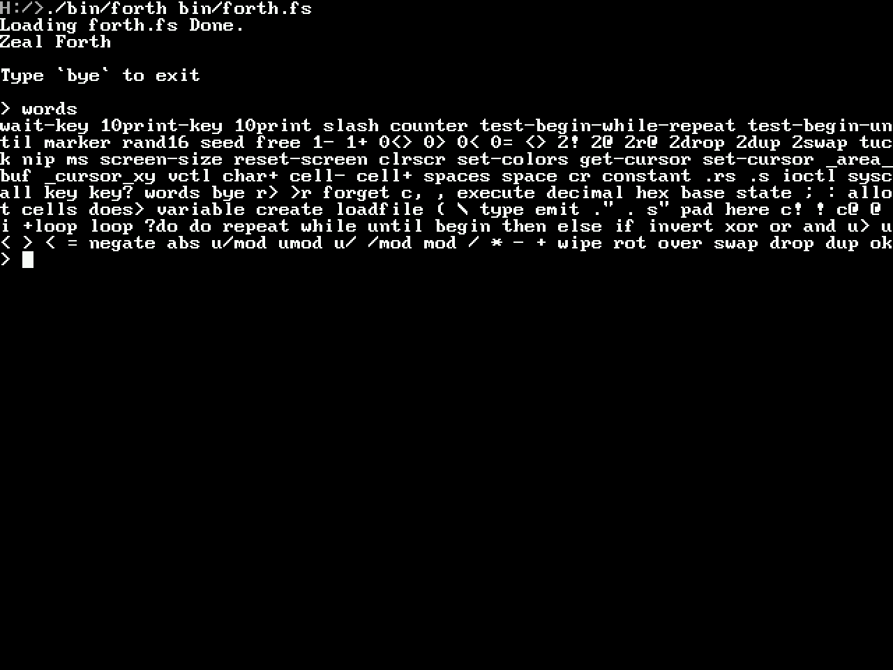
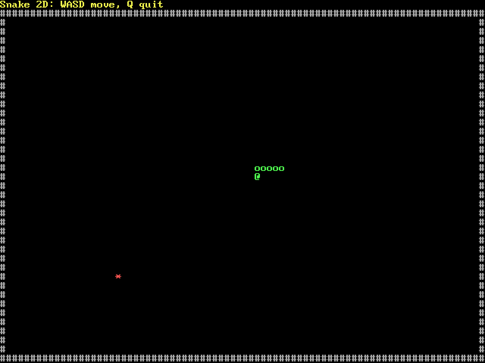
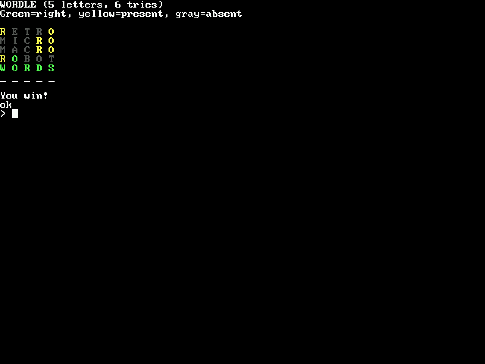
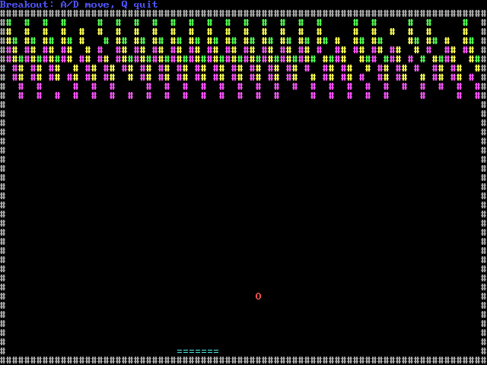

# zeal-forth

Forth implementation for Zeal 8-bit Computer

## Forth language support

Zeal Forth is a native 16-bit Forth for the Z80. It provides colon definitions,
variables and defining words, data and return stacks, signed and unsigned
arithmetic, memory access, strings and character I/O, conditionals, indefinite
loops, and counted `do`/`?do` loops. Numbers default to decimal; hexadecimal input
and output are also supported. Flags use `0` for false and `-1` for true.

The interpreter starts with a core dictionary implemented in assembly. Optional
[`forth.fs`](forth.fs) adds convenience, ZealOS, screen, timing, and random-number
words written in Forth. See [the word reference](docs/words.md) for separate
built-in and library word lists with stack effects.

Parser, compiler, stack, and error details live in
[the documentation index](docs/README.md).

## Screenshots

| | |
| --- | --- |
|  |  |
| *Startup screen after typing `words`.* | *Snake, written in Forth.* |
|  |  |
| *Wordle, written in Forth.* | *Breakout, written in Forth.* |

## Installation

## Building from source

Make sure that you have [ZDE](https://github.com/zoul0813/zeal-dev-environment) installed.

Then open a terminal, go to the source directory and type the following commands:

```shell
zde cmake
```

Multiple Forth source files can be loaded in order from the command line:

```shell
forth forth.fs tests/unit/base.fs
```
